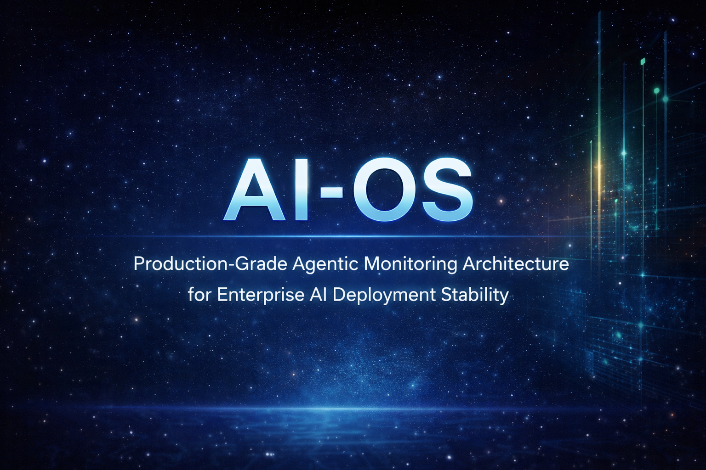
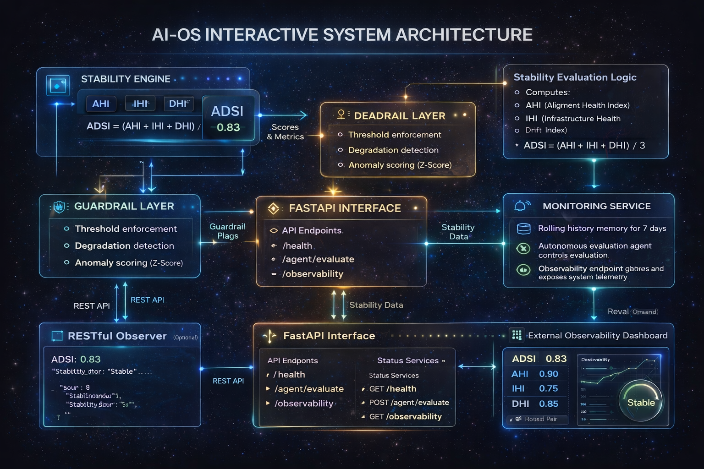
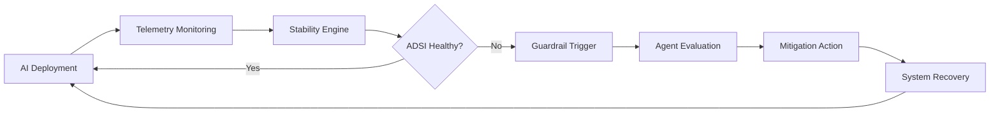

# MI4,Inc.

**Certified under the Production-Grade Agentic System module in the Agentic AI In Production**

### AI-OS

AI-OS is a stability-centric supervisory architecture for enterprise AI deployments.

#### Live demo

Explore the [AI-OS dashboard](https://ai-osdev.streamlit.app/).

   

<div align="center"></div>

<p align="center">Research dashboard for exploring instability and operational drift in AI deployments. The Streamlit demo keeps history only in a browser session. The separate FastAPI/SQLite service is not production-approved; see [operational readiness](docs/operational-readiness-005c.md).</p>

#### Dashboard preview


#### User interface

AI-OS includes an interactive monitoring dashboard built with Streamlit.

The dashboard provides:

* Real-time ADSI computation
* Stability-tier classification
* Temporal stability trends
* Anomaly-detection signals

To run the dashboard locally:

```bash
streamlit run app.py

```

***

#### Core capabilities

| Capability                      | Description                                 |
| ------------------------------- | ------------------------------------------- |
| Deployment stability monitoring | Continuously evaluates AI deployment health |
| AI Deployment Stability Index   | Provides a unified stability metric         |
| Guardrail mechanisms            | Detect anomalies and trigger mitigation     |
| Telemetry observability         | Monitors system signals in real time        |
| Agentic monitoring              | Evaluates stability and recovery loops      |

***

#### Research visual abstract

AI-OS monitors deployed AI systems and coordinates recovery when stability declines.

| Stage                | Function                     |
| -------------------- | ---------------------------- |
| Telemetry Monitoring | Collect runtime metrics      |
| Stability Engine     | Compute ADSI stability score |
| Guardrail System     | Detect anomaly thresholds    |
| Monitoring Agent     | Evaluate degradation         |
| Mitigation Action    | Trigger recovery workflows   |
| System Recovery      | Restore stable deployment    |

AI-OS shifts monitoring from metric tracking to deployment-stability supervision.

***

#### Overview

AI-OS monitors deployed AI systems through a stability-centric supervisory architecture.

The AI Deployment Stability Index (ADSI) combines alignment, infrastructure, and drift signals. Agentic monitoring loops and guardrails identify degradation and coordinate mitigation before service failure.

***

#### Contents

* [Why AI-OS exists](./#why-ai-os-exists)
* [Research contributions](./#research-contributions)
* [System architecture](./#system-architecture)
* [Architecture components](./#architecture-components)
* [Stability model](./#stability-model)
* [AI-OS monitoring pipeline](./#ai-os-monitoring-pipeline)
* [Deployment failure case study](./#deployment-failure-case-study)
* [Benchmark comparison](./#benchmark-comparison)
* [Installation](./#installation)
* [API endpoints](./#api-endpoints)
* [Reproducibility](./#reproducibility)
* [Enterprise impact](./#enterprise-impact)
* [System performance benchmarks](./#system-performance-benchmarks)
* [Future work](./#future-work)
* [Key takeaways](./#key-takeaways)

***

#### Why AI-OS exists

Enterprise AI deployments can fail gradually and silently.

Failures rarely result from one event. Degradation can accumulate through:

* Latency drift
* Retrieval degradation
* Infrastructure instability
* Embedding-distribution shifts

Many monitoring tools focus on infrastructure metrics or model performance alone. AI-OS monitors the complete AI deployment pipeline with a unified stability signal.

The system evaluates deployment health using a unified stability signal:

#### AI Deployment Stability Index (ADSI)

ADSI provides an interpretable signal across alignment, infrastructure, and drift dimensions.

***

#### Research contributions

AI-OS applies stability-centric operations to AI deployments.

**Unified stability metric**

The AI Deployment Stability Index (ADSI) aggregates health indicators into one interpretable score.

$$
\mathrm{ADSI} = \frac{\mathrm{AHI} + \mathrm{IHI} + \mathrm{DHI}}{3}
$$

The score uses three health indexes:

* **AHI**: Alignment Health Index
* **IHI**: Infrastructure Health Index
* **DHI**: Drift Health Index

***

**Agentic monitoring architecture**

AI-OS integrates monitoring agents capable of evaluating deployment health and triggering guardrail responses.

Capabilities include:

* Runtime telemetry monitoring
* Anomaly detection
* Guardrail-mitigation triggers
* Stability-trend evaluation

***

**Deployment-level observability**

AI-OS monitors complete AI deployment pipelines, including:

* Retrieval systems
* Latency behavior
* Embedding-distribution shifts
* System response quality

This provides deployment-level monitoring.

***

#### System architecture

<div align="center"></div>

AI-OS integrates monitoring, evaluation, and guardrail mechanisms into a unified architecture.

**Architecture components**

The AI-OS architecture consists of several modular components responsible for monitoring deployment stability.

| Component              | Role                                                                                                        |
| ---------------------- | ----------------------------------------------------------------------------------------------------------- |
| Telemetry Layer        | Collects runtime metrics including latency deviation, embedding drift, and retrieval quality                |
| Stability Engine       | Computes the AI Deployment Stability Index (ADSI) using alignment, infrastructure, and drift health signals |
| Guardrail System       | Detects instability thresholds and triggers mitigation events                                               |
| Monitoring Service     | Evaluates telemetry streams and orchestrates monitoring workflows                                           |
| Agent Evaluation Layer | Performs autonomous stability assessment and generates recovery recommendations                             |
| Observability API      | Exposes deployment health metrics via FastAPI endpoints                                                     |
| Recovery Loop          | Enables automated mitigation and stabilization of AI deployments                                            |

These components provide continuous monitoring, anomaly detection, and recovery orchestration.

***

#### Stability model

AI-OS evaluates deployment health across three stability dimensions.

**Alignment Health Index**

$$
\mathrm{AHI} = 1 - K_e
$$

Where $K\_e$ is the KPI alignment error.

**Infrastructure Health Index**

$$
\mathrm{IHI} = R_s
$$

Where $R\_s$ is the retrieval-quality score.

**Drift Health Index**

$$
\mathrm{DHI} = 1 - \frac{L_d + E_s}{2}
$$

Where $L\_d$ is latency deviation and $E\_s$ is embedding drift.

**AI Deployment Stability Index**

$$
\mathrm{ADSI} = \frac{\mathrm{AHI} + \mathrm{IHI} + \mathrm{DHI}}{3}
$$

ADSI provides one interpretable stability signal for deployment health.

***

#### AI-OS monitoring pipeline



This loop detects instability early and coordinates automated recovery.

***

#### Deployment failure case study

Enterprise AI deployments degrade gradually rather than failing instantly.

AI-OS detects early instability signals through ADSI monitoring.

**Failure progression**

1. The deployment is stable.
2. The system detects embedding drift.
3. Latency degrades and ADSI falls.
4. A guardrail triggers agent evaluation.
5. The system initiates mitigation and recovery.

***

**Example telemetry timeline**

| Cycle | Event                      | ADSI |
| ----- | -------------------------- | ---- |
| 0     | Stable system              | 0.92 |
| 20    | Latency deviation detected | 0.86 |
| 40    | Embedding drift observed   | 0.79 |
| 60    | Guardrail triggered        | 0.72 |
| 80    | Recovery initiated         | 0.84 |
| 100   | System stabilized          | 0.90 |

***

#### Benchmark comparison

| **System**             | **Monitoring Scope**         | **Drift Detection** | **Stability Metric** | **Infrastructure Monitoring** |
| ---------------------- | ---------------------------- | ------------------- | -------------------- | ----------------------------- |
| Prometheus             | Infrastructure               | No                  | No                   | Yes                           |
| Evidently AI           | Data Drift                   | Yes                 | No                   | No                            |
| Model Monitoring Tools | Model Metrics                | Yes                 | No                   | No                            |
| **AI-OS**              | **End-to-End AI Deployment** | **Yes**             | **ADSI**             | **Yes**                       |

AI-OS provides deployment-level stability monitoring.

***

#### Installation

To set up the service:

1.  Clone the repository:

    ```bash
    git clone https://github.com/strdst7/ai-os.git
    cd ai-os
    ```
2.  Create and activate a virtual environment:

    ```bash
    python -m venv venv
    source venv/bin/activate
    ```
3.  Install the dependencies:

    ```bash
    pip install -r requirements.txt
    ```
4.  Start the service:

    ```bash
    uvicorn src.main:app --reload
    ```

***

#### Prerequisites

* Python 3.10 or later
* FastAPI and Uvicorn
* NumPy, Pandas, and Matplotlib
* Pytest

***

#### API endpoints

| Endpoint          | Description                          |
| ----------------- | ------------------------------------ |
| `/health`         | Returns system health                |
| `/agent/evaluate` | Evaluates deployment stability       |
| `/observability`  | Returns deployment telemetry metrics |

***

#### Reproducibility

The example telemetry dataset contains 500 synthetic monitoring cycles across stable, warning, and critical phases:

`data/sample_telemetry.json`

Regenerate it deterministically with:

```
python tools/generate_sample_telemetry.py
```

The executed analysis notebook includes stored outputs:

`notebooks/reproducibility_analysis.ipynb`

It validates the dataset against the `Telemetry` schema. It computes ADSI for each cycle, plots tier transitions and sub-index decomposition, replays the rolling z-score detector, and measures guardrail-trigger timing.

Rebuild it after changing the dataset:

```
pip install nbformat nbclient ipykernel   # notebook toolchain (not run by CI)
python tools/build_reproducibility_notebook.py
```

In this synthetic series, the composite ADSI triggers later than the drift sub-index. The composite triggers at cycle 364, while the drift sub-index triggers at cycle 279. The composite favors robustness and one interpretable alert over earlier detection.

Supplementary materials include benchmark charts and stability-timeline visualizations.

***

#### Enterprise impact

AI-OS supports production AI systems in high-reliability environments.

The architecture enables organizations to detect and mitigate AI system degradation before it results in service disruption.

Potential deployment scenarios include:

| Domain                                 | Use Case                                                |
| -------------------------------------- | ------------------------------------------------------- |
| Enterprise AI Platforms                | Monitor reliability of deployed LLM pipelines           |
| Retrieval-Augmented Generation Systems | Detect embedding drift and retrieval degradation        |
| Customer Support Automation            | Ensure response latency and quality stability           |
| Financial AI Systems                   | Monitor model-system interaction anomalies              |
| Smart Infrastructure Systems           | Detect system instability in real-time AI control loops |

AI-OS can operate alongside existing infrastructure-monitoring platforms.

***

#### System performance benchmarks

The stability evaluation engine is designed for real-time deployment monitoring with minimal computational overhead.

| Metric                       | Performance                   |
| ---------------------------- | ----------------------------- |
| Stability Evaluation Latency | < 5 ms                        |
| Telemetry Processing         | Real-time                     |
| Guardrail Trigger Detection  | Instant threshold detection   |
| Monitoring Throughput        | Scalable with deployment load |

This enables AI-OS to function as a lightweight supervisory layer across multiple deployments.

***

#### Future work

Future development focuses on:

* Multi-agent monitoring orchestration
* Reinforcement-learning guardrails
* Automated deployment self-healing
* Cross-deployment stability benchmarking

***

#### Key takeaways

* AI-OS provides a stability-centric supervisory architecture for deployed AI systems.
* ADSI combines alignment, infrastructure, and drift signals.
* Guardrail-driven loops detect degradation and coordinate mitigation.
* The architecture supports stability-aware operations for enterprise deployments.

***

#### License

AI-OS is available under the MIT License.

***

#### Citation

If you use AI-OS in research:

Nur Amirah Mohd Kamil. _AI-OS: Stability-Centric Supervisory Architecture for Enterprise AI Deployments_. 2026.

***

#### Author

Nur Amirah Mohd Kamil
