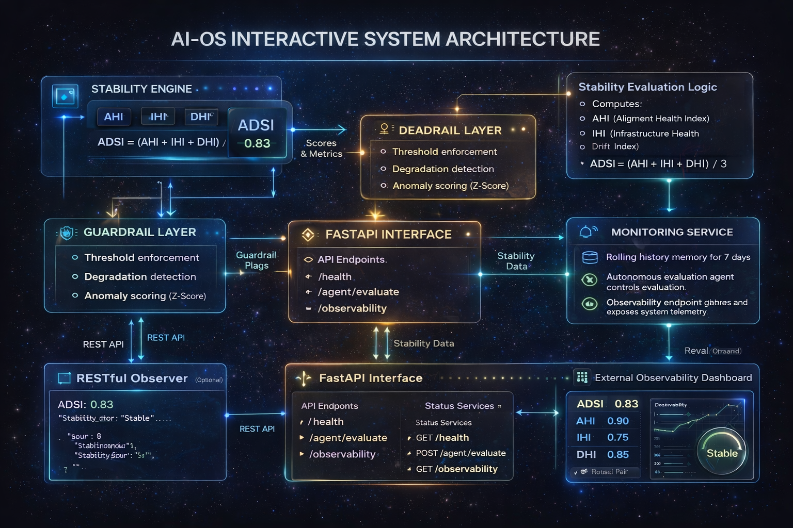
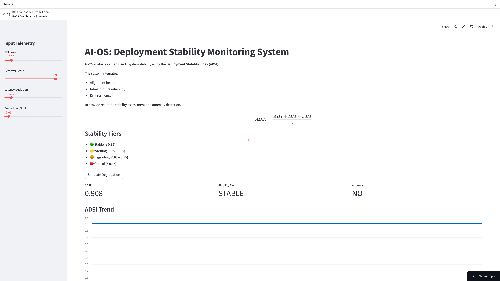

# AI-OS: A Stability-Centric Supervisory Architecture for Enterprise AI Deployment

## AI-OS: A Stability-Centric Supervisory Architecture for Enterprise AI Deployment

[Like](https://app.readytensor.ai/signup)[Bookmark](https://app.readytensor.ai/signup)


𝗡𝘂𝗿 𝗔𝗺𝗶𝗿𝗮𝗵 𝗠𝗼𝗵𝗱 𝗞𝗮𝗺𝗶𝗹\
𝗜𝗻𝗱𝗲𝗽𝗲𝗻𝗱𝗲𝗻𝘁 𝗔𝗜 𝗦𝘆𝘀𝘁𝗲𝗺𝘀 𝗔𝗿𝗰𝗵𝗶𝘁𝗲𝗰𝘁\
𝗘𝗻𝘁𝗲𝗿𝗽𝗿𝗶𝘀𝗲 𝗔𝗜 𝗚𝗼𝘃𝗲𝗿𝗻𝗮𝗻𝗰𝗲 & 𝗗𝗲𝗽𝗹𝗼𝘆𝗺𝗲𝗻𝘁 𝗦𝘁𝗿𝗮𝘁𝗲𝗴𝘆

## Monitoring Architecture for Enterprise AI Deployment Stability <a href="#monitoring_architecture_for_enterprise_ai_deployment_stability" id="monitoring_architecture_for_enterprise_ai_deployment_stability"></a>

#### AI-OS: A Stability-Centric Supervisory Architecture <a href="#ai-os_a_stability-centric_supervisory_architecture" id="ai-os_a_stability-centric_supervisory_architecture"></a>

_𝙷𝚘𝚠 𝚌𝚊𝚗 𝚎𝚗𝚝𝚎𝚛𝚙𝚛𝚒𝚜𝚎𝚜 𝚍𝚎𝚝𝚎𝚌𝚝 𝙰𝙸 𝚜𝚢𝚜𝚝𝚎𝚖 𝚏𝚊𝚒𝚕𝚞𝚛𝚎 𝚋𝚎𝚏𝚘𝚛𝚎 𝚒𝚝 𝚑𝚊𝚙𝚙𝚎𝚗𝚜? 𝙰𝙸-𝙾𝚂 𝚒𝚗𝚝𝚛𝚘𝚍𝚞𝚌𝚎𝚜 𝚊 𝚌𝚘𝚖𝚙𝚘𝚜𝚒𝚝𝚎 𝚜𝚝𝚊𝚋𝚒𝚕𝚒𝚝𝚢 𝚏𝚛𝚊𝚖𝚎𝚠𝚘𝚛𝚔 𝚝𝚑𝚊𝚝 𝚝𝚛𝚊𝚗𝚜𝚏𝚘𝚛𝚖𝚜 𝙰𝙸 𝚖𝚘𝚗𝚒𝚝𝚘𝚛𝚒𝚗𝚐 𝚏𝚛𝚘𝚖 𝚖𝚎𝚝𝚛𝚒𝚌 𝚝𝚛𝚊𝚌𝚔𝚒𝚗𝚐 𝚒𝚗𝚝𝚘 𝚜𝚞𝚛𝚟𝚒𝚟𝚊𝚋𝚒𝚕𝚒𝚝𝚢 𝚖𝚘𝚍𝚎𝚕𝚒𝚗𝚐_.

⸻\
ᴇxᴇᴄᴜᴛɪᴠᴇ ꜱᴜᴍᴍᴀʀʏ

Enterprise AI deployments rarely fail instantly. Instead, they degrade progressively through compounded drift, infrastructure instability, and KPI misalignment. Traditional monitoring tools track individual metrics but fail to model the overall survivability of deployed AI systems.

AI-OS introduces a stability-centric supervisory architecture that formalizes deployment health through a bounded composite metric: the AI Deployment Stability Index (ADSI). By integrating alignment integrity, infrastructure reliability, and drift resilience into a unified stability model, AI-OS enables:\
• early degradation detection\
• structured stability-tier classification\
• governance-aligned mitigation

The architecture reframes monitoring as a feedback-regulated supervisory layer combining composite stability modeling, anomaly detection, and automated guardrails.

𝗞𝗲𝘆 𝗖𝗼𝗻𝘁𝗿𝗶𝗯𝘂𝘁𝗶𝗼𝗻𝘀\
𝟷. 𝙲𝚘𝚖𝚙𝚘𝚜𝚒𝚝𝚎 𝚂𝚝𝚊𝚋𝚒𝚕𝚒𝚝𝚢 𝙼𝚘𝚍𝚎𝚕𝚒𝚗𝚐\
𝙰 𝚋𝚘𝚞𝚗𝚍𝚎𝚍 𝚜𝚝𝚊𝚋𝚒𝚕𝚒𝚝𝚢 𝚖𝚎𝚝𝚛𝚒𝚌 (𝙰𝙳𝚂𝙸) 𝚒𝚗𝚝𝚎𝚐𝚛𝚊𝚝𝚎𝚜 𝚖𝚞𝚕𝚝𝚒𝚙𝚕𝚎 𝚜𝚞𝚋𝚜𝚢𝚜𝚝𝚎𝚖 𝚜𝚒𝚐𝚗𝚊𝚕𝚜 𝚒𝚗𝚝𝚘 𝚊 𝚜𝚒𝚗𝚐𝚕𝚎 𝚒𝚗𝚝𝚎𝚛𝚙𝚛𝚎𝚝𝚊𝚋𝚕𝚎 𝚜𝚌𝚘𝚛𝚎.\
𝟸. 𝚂𝚞𝚙𝚎𝚛𝚟𝚒𝚜𝚘𝚛𝚢 𝙼𝚘𝚗𝚒𝚝𝚘𝚛𝚒𝚗𝚐 𝙰𝚛𝚌𝚑𝚒𝚝𝚎𝚌𝚝𝚞𝚛𝚎\
𝙰 𝚕𝚊𝚢𝚎𝚛𝚎𝚍 𝚜𝚢𝚜𝚝𝚎𝚖 𝚌𝚘𝚖𝚋𝚒𝚗𝚒𝚗𝚐 𝚎𝚟𝚊𝚕𝚞𝚊𝚝𝚒𝚘𝚗, 𝚊𝚗𝚘𝚖𝚊𝚕𝚢 𝚍𝚎𝚝𝚎𝚌𝚝𝚒𝚘𝚗, 𝚊𝚗𝚍 𝚐𝚞𝚊𝚛𝚍𝚛𝚊𝚒𝚕 𝚎𝚗𝚏𝚘𝚛𝚌𝚎𝚖𝚎𝚗𝚝.\
𝟹. 𝙶𝚘𝚟𝚎𝚛𝚗𝚊𝚗𝚌𝚎 𝚃𝚛𝚊𝚗𝚜𝚕𝚊𝚝𝚒𝚘𝚗 𝙻𝚊𝚢𝚎𝚛\
𝚂𝚝𝚊𝚋𝚒𝚕𝚒𝚝𝚢 𝚝𝚒𝚎𝚛𝚜 𝚖𝚊𝚙𝚙𝚎𝚍 𝚍𝚒𝚛𝚎𝚌𝚝𝚕𝚢 𝚝𝚘 𝚘𝚙𝚎𝚛𝚊𝚝𝚒𝚘𝚗𝚊𝚕 𝚊𝚌𝚝𝚒𝚘𝚗𝚜.\
𝟺. 𝙿𝚛𝚘𝚍𝚞𝚌𝚝𝚒𝚘𝚗-𝙶𝚛𝚊𝚍𝚎 𝙸𝚖𝚙𝚕𝚎𝚖𝚎𝚗𝚝𝚊𝚝𝚒𝚘𝚗\
𝙵𝚊𝚜𝚝𝙰𝙿𝙸 𝚋𝚊𝚌𝚔𝚎𝚗𝚍, 𝙲𝙸/𝙲𝙳 𝚙𝚒𝚙𝚎𝚕𝚒𝚗𝚎, 𝚊𝚞𝚝𝚘𝚖𝚊𝚝𝚎𝚍 𝚝𝚎𝚜𝚝𝚒𝚗𝚐, 𝚊𝚗𝚍 𝚕𝚒𝚟𝚎 𝚍𝚊𝚜𝚑𝚋𝚘𝚊𝚛𝚍.\
𝟻. 𝙳𝚎𝚙𝚕𝚘𝚢𝚖𝚎𝚗𝚝-𝙵𝚘𝚌𝚞𝚜𝚎𝚍 𝚂𝚝𝚊𝚋𝚒𝚕𝚒𝚝𝚢 𝙵𝚛𝚊𝚖𝚎𝚠𝚘𝚛𝚔\
𝚁𝚎𝚏𝚛𝚊𝚖𝚎𝚜 𝚖𝚘𝚗𝚒𝚝𝚘𝚛𝚒𝚗𝚐 𝚏𝚛𝚘𝚖 𝚖𝚎𝚝𝚛𝚒𝚌 𝚘𝚋𝚜𝚎𝚛𝚟𝚊𝚝𝚒𝚘𝚗 𝚝𝚘 𝚜𝚞𝚛𝚟𝚒𝚟𝚊𝚋𝚒𝚕𝚒𝚝𝚢 𝚖𝚘𝚍𝚎𝚕𝚒𝚗𝚐.

⸻

𝙒𝙝𝙮 𝙏𝙝𝙞𝙨 𝙈𝙖𝙩𝙩𝙚𝙧𝙨

Enterprise AI systems are now operational infrastructure. However, current monitoring practices focus on isolated signals (latency, drift, etc.) without evaluating overall system stability.

This creates a critical gap:

Systems can be observable without being survivable.

AI-OS addresses this by enabling:

```
•	early detection of compound degradation
•	structured escalation via stability tiers
•	alignment between monitoring and governance
```

**ᴀʙꜱᴛʀᴀᴄᴛ**

Enterprise AI systems rarely fail abruptly; instead, they degrade progressively through compounded drift, infrastructure instability, and KPI misalignment. Despite rapid advances in model capability, deployment survivability remains under-formalized as a systems property. Existing monitoring frameworks observe isolated operational metrics but lack composite stability modeling and governance-aligned enforcement mechanisms.

This work introduces **AI-OS**, a production-grade supervisory architecture that formalizes AI deployment stability through a bounded composite metric termed the **AI Deployment Stability Index (ADSI)**. By integrating alignment integrity, infrastructure robustness, and drift resilience into a deterministic stability function, AI-OS enables early degradation detection, structured stability-tier classification, and governance-aligned mitigation workflows.

Grounded in principles from **control systems theory and reliability engineering**, AI-OS reframes monitoring from passive observability dashboards toward an active supervisory feedback layer. Experimental degradation simulations and applied deployment case studies demonstrate earlier compound-failure detection and structured escalation compared to conventional metric-based monitoring approaches. AI-OS establishes stability modeling as a foundational construct for enterprise AI governance.

𝟏 𝐈𝐧𝐭𝐫𝐨𝐝𝐮𝐜𝐭𝐢𝐨𝐧

Enterprise AI has transitioned from experimental capability to operational infrastructure. Large language models (LLMs), retrieval-augmented generation (RAG), and agentic pipelines increasingly support mission-critical workflows across finance, healthcare, logistics, and customer operations.

However, deployment oversight remains fragmented. Typical monitoring stacks track metrics such as:

• latency\
• drift signals\
• retrieval quality\
• cost utilization\
• error rates

These metrics are typically evaluated independently. Yet enterprise AI failures rarely originate from a single subsystem. Instead, they emerge from **compound degradation across interacting components**.

This creates a critical oversight gap:

**Organizations can observe metrics without evaluating survivability**.

AI-OS addresses this gap by formalizing deployment stability as a **bounded composite systems property** that is measurable, enforceable, and governance-aligned.

𝟮 𝗧𝗵𝗲𝗼𝗿𝗲𝘁𝗶𝗰𝗮𝗹 𝗙𝗿𝗮𝗺𝗶𝗻𝗴

𝟮.𝟭 𝗗𝗲𝗽𝗹𝗼𝘆𝗺𝗲𝗻𝘁 𝗮𝘀 𝗮 𝗙𝗲𝗲𝗱𝗯𝗮𝗰𝗸-𝗥𝗲𝗴𝘂𝗹𝗮𝘁𝗲𝗱 𝗦𝘆𝘀𝘁𝗲𝗺

AI deployments can be modeled as dynamical systems composed of interacting subsystems. In classical control systems theory, system stability refers to the ability of a system to maintain bounded behavior under perturbations.

AI-OS introduces a bounded composite function:

𝐀𝐃𝐒𝐈 ∈ \[𝟎,𝟏]

This enables deterministic stability classification analogous to stability regions in classical dynamical systems.

Guardrails act as supervisory constraints, regulating transitions between stability tiers.

𝟮.𝟮 𝗥𝗲𝗹𝗶𝗮𝗯𝗶𝗹𝗶𝘁𝘆 𝗘𝗻𝗴𝗶𝗻𝗲𝗲𝗿𝗶𝗻𝗴 𝗣𝗲𝗿𝘀𝗽𝗲𝗰𝘁𝗶𝘃𝗲

Reliability engineering models system survivability as a function of subsystem integrity. Failures often arise from cumulative micro-degradations rather than single catastrophic faults.

AI-OS models survivability probability as:

𝒮(𝓉) = 𝒫(𝒜𝒟𝒮𝐼(𝓉) > \𝓉𝒶𝓊)

This reframes monitoring from simple threshold alerts toward **survivability estimation across deployment lifecycles**.

𝟯 𝗙𝗼𝗿𝗺𝗮𝗹 𝗦𝘁𝗮𝗯𝗶𝗹𝗶𝘁𝘆 𝗠𝗼𝗱𝗲𝗹

AI-OS defines three normalized subsystem indices:

𝗔𝗹𝗶𝗴𝗻𝗺𝗲𝗻𝘁 𝗛𝗲𝗮𝗹𝘁𝗵 𝗜𝗻𝗱𝗲𝘅 (𝗔𝗛𝗜)\
𝗜𝗻𝗳𝗿𝗮𝘀𝘁𝗿𝘂𝗰𝘁𝘂𝗿𝗲 𝗛𝗲𝗮𝗹𝘁𝗵 𝗜𝗻𝗱𝗲𝘅 (𝗜𝗛𝗜)\
𝗗𝗿𝗶𝗳𝘁 𝗛𝗲𝗮𝗹𝘁𝗵 𝗜𝗻𝗱𝗲𝘅 (𝗗𝗛𝗜)

Mathematically:

𝙰𝙷𝙸 = 𝟷 − 𝙺𝙿𝙸\_𝚎𝚛𝚛𝚘𝚛\
𝙸𝙷𝙸 = 𝚁𝚎𝚝𝚛𝚒𝚎𝚟𝚊𝚕\_𝚜𝚌𝚘𝚛𝚎\
𝙳𝙷𝙸 = 𝟷 − (𝙻𝚊𝚝𝚎𝚗𝚌𝚢\_𝚍𝚎𝚟𝚒𝚊𝚝𝚒𝚘𝚗 + 𝙴𝚖𝚋𝚎𝚍𝚍𝚒𝚗𝚐\_𝚜𝚑𝚒𝚏𝚝)/𝟸

Composite stability is computed as:

ᴀᴅꜱɪ = \ꜰʀᴀᴄ{ᴀʜɪ + ɪʜɪ + ᴅʜɪ}{3}

All variables are normalized to the interval \[𝟬,𝟭].

𝗦𝘁𝗮𝗯𝗶𝗹𝗶𝘁𝘆 𝗧𝗶𝗲𝗿 𝗖𝗹𝗮𝘀𝘀𝗶𝗳𝗶𝗰𝗮𝘁𝗶𝗼𝗻

| ADSI Range | Stability Tier |
| ---------- | -------------- |
| ≥ 0.85     | Stable         |
| 0.75–0.85  | Warning        |
| 0.65–0.75  | Degrading      |
| < 0.65     | Critical       |

This tier structure enables structured operational responses.

𝟰 𝗦𝘆𝘀𝘁𝗲𝗺 𝗔𝗿𝗰𝗵𝗶𝘁𝗲𝗰𝘁𝘂𝗿𝗲



AI-OS follows a modular supervisory architecture designed to integrate monitoring, evaluation, and mitigation.

𝟰.𝟭 𝗦𝘁𝗮𝗯𝗶𝗹𝗶𝘁𝘆 𝗘𝗻𝗴𝗶𝗻𝗲

Computes subsystem indices and the ADSI composite stability score.

𝟰.𝟮 𝗚𝘂𝗮𝗿𝗱𝗿𝗮𝗶𝗹 𝗟𝗮𝘆𝗲𝗿

Implements enforcement logic including:

• stability threshold enforcement\
• Z-score anomaly detection\
• degradation classification\
• escalation triggers

𝟰.𝟯 𝗠𝗼𝗻𝗶𝘁𝗼𝗿𝗶𝗻𝗴 𝗦𝗲𝗿𝘃𝗶𝗰𝗲

Maintains rolling telemetry buffers and autonomous evaluation loops that continuously compute system health.

𝟰.𝟰 𝗣𝗿𝗼𝗱𝘂𝗰𝘁𝗶𝗼𝗻 𝗕𝗮𝗰𝗸𝗲𝗻𝗱

Reference implementation components include:

• 𝙿𝚢𝚝𝚑𝚘𝚗 𝟹.𝟷𝟷\
• 𝙵𝚊𝚜𝚝𝙰𝙿𝙸 ≥ 𝟶.𝟷𝟷𝟶\
• 𝚄𝚟𝚒𝚌𝚘𝚛𝚗 ≥ 𝟶.𝟸𝟽\
• 𝙿𝚢𝚍𝚊𝚗𝚝𝚒𝚌 𝚟𝟸\
• 𝙽𝚞𝚖𝙿𝚢 ≥ 𝟷.𝟸𝟼\
• 𝙳𝚘𝚌𝚔𝚎𝚛 (𝚘𝚙𝚝𝚒𝚘𝚗𝚊𝚕 𝚍𝚎𝚙𝚕𝚘𝚢𝚖𝚎𝚗𝚝)

**User Interface**

Live dashboard:

👉 <a href="https://ai-osdev.streamlit.app/" target="_blank">https://ai-osdev.streamlit.app/</a>

𝟱 𝗧𝗲𝗰𝗵𝗻𝗶𝗰𝗮𝗹 𝗔𝘀𝘀𝘂𝗺𝗽𝘁𝗶𝗼𝗻𝘀

AI-OS is built under several explicit assumptions:\
1\. Subsystem metrics can be normalized into bounded ranges.\
2\. Subsystems can be approximated as semi-independent first-order components.\
3\. Rolling window statistics assume short-term stationarity.\
4\. Initial implementation applies uniform weighting across subsystem indices.\
5\. Continuous telemetry access is available.

Limitations include static weighting and absence of explicit cascading dependency modeling.

𝟲 𝗗𝗮𝘁𝗮𝘀𝗲𝘁 𝗗𝗲𝘀𝗰𝗿𝗶𝗽𝘁𝗶𝗼𝗻

𝗔𝗜-𝗢𝗦 𝗦𝘁𝗮𝗯𝗶𝗹𝗶𝘁𝘆 𝗧𝗲𝗹𝗲𝗺𝗲𝘁𝗿𝘆 𝗗𝗮𝘁𝗮𝘀𝗲𝘁 𝘃𝟭.𝟬

File:

𝚍𝚊𝚝𝚊/𝚜𝚊𝚖𝚙𝚕𝚎\_𝚝𝚎𝚕𝚎𝚖𝚎𝚝𝚛𝚢.𝚓𝚜𝚘𝚗

The dataset contains **500 simulated evaluation cycles** across three degradation phases.

Each telemetry record includes:

• timestamp\
• kpi\_error\
• retrieval\_score\
• latency\_deviation\
• embedding\_shift

Synthetic telemetry ensures reproducible evaluation while preserving enterprise confidentiality.

𝟳 𝗗𝗮𝘁𝗮 𝗣𝗿𝗼𝗰𝗲𝘀𝘀𝗶𝗻𝗴 𝗠𝗲𝘁𝗵𝗼𝗱𝗼𝗹𝗼𝗴𝘆

The AI-OS telemetry pipeline follows five stages:\
1\. Metric normalization\
2\. Missing value handling via rolling mean fallback\
3\. Three-sigma outlier clipping\
4\. ADSI stability computation\
5\. Z-score anomaly detection

Anomaly detection is defined as:

𝚣 = \𝚏𝚛𝚊𝚌{𝙰𝙳𝚂𝙸\_𝚝 - \𝚖𝚞\_{𝚠𝚒𝚗𝚍𝚘𝚠\}}{\𝚜𝚒𝚐𝚖𝚊\_{𝚠𝚒𝚗𝚍𝚘𝚠\}}

An anomaly is triggered when:

|𝘻| > 2

𝟴 𝗘𝘅𝗽𝗲𝗿𝗶𝗺𝗲𝗻𝘁𝗮𝗹 𝗦𝗶𝗺𝘂𝗹𝗮𝘁𝗶𝗼𝗻

A three-phase degradation experiment was conducted:

ℙ𝕙𝕒𝕤𝕖 𝟙 — 𝕊𝕥𝕒𝕓𝕝𝕖\
𝔸𝔻𝕊𝕀 ≈ 𝟘.𝟡𝟜

ℙ𝕙𝕒𝕤𝕖 𝟚 — 𝕎𝕒𝕣𝕟𝕚𝕟𝕘\
𝔸𝔻𝕊𝕀 ≈ 𝟘.𝟠𝟛

ℙ𝕙𝕒𝕤𝕖 𝟛 — ℂ𝕣𝕚𝕥𝕚𝕔𝕒𝕝\
𝔸𝔻𝕊𝕀 ≈ 𝟘.𝟞𝟜

Results demonstrate:

• monotonic stability decline under compound degradation\
• earlier composite detection relative to individual metrics\
• structured tier transitions enabling proactive mitigation

𝟵 𝗔𝗽𝗽𝗹𝗶𝗲𝗱 𝗗𝗲𝗽𝗹𝗼𝘆𝗺𝗲𝗻𝘁 𝗖𝗮𝘀𝗲 𝗦𝘁𝘂𝗱𝗶𝗲𝘀

𝗖𝗮𝘀𝗲 𝗔 — 𝗦𝘁𝗮𝗯𝗶𝗹𝗶𝘇𝗲𝗱 𝗥𝗔𝗚 𝗔𝘀𝘀𝗶𝘀𝘁𝗮𝗻𝘁

During a traffic surge, latency volatility increased.

ADSI declined:

0.91 → 0.84

AI-OS triggered the **Warning tier** and anomaly detection.

Infrastructure scaling and retrieval caching restored stability:

0.92

**Lesson**: early composite detection prevented SLA breach.

⸻

𝗖𝗮𝘀𝗲 𝗕 — 𝗖𝗼𝗺𝗽𝗼𝘂𝗻𝗱 𝗗𝗿𝗶𝗳𝘁 𝗮𝗻𝗱 𝗜𝗻𝗳𝗿𝗮𝘀𝘁𝗿𝘂𝗰𝘁𝘂𝗿𝗲 𝗗𝗲𝗴𝗿𝗮𝗱𝗮𝘁𝗶𝗼𝗻

A backend update introduced retrieval decay and embedding drift.

ADSI trajectory:

0.89 → 0.76 → 0.63

Guardrail escalation triggered rollback and index rebuild.

**Lesson**: composite stability modeling detected compounding degradation earlier than isolated alerts.

𝟭𝟬 𝗖𝗼𝗺𝗽𝗮𝗿𝗮𝘁𝗶𝘃𝗲 𝗔𝗻𝗮𝗹𝘆𝘀𝗶𝘀

| 𝗦𝘆𝘀𝘁𝗲𝗺 | 𝗖𝗼𝗺𝗽𝗼𝘀𝗶𝘁𝗲 𝗦𝘁𝗮𝗯𝗶𝗹𝗶𝘁𝘆 | 𝗗𝗿𝗶𝗳𝘁 𝗠𝗼𝗱𝗲𝗹𝗶𝗻𝗴 | 𝗚𝗼𝘃𝗲𝗿𝗻𝗮𝗻𝗰𝗲 𝗘𝗻𝗳𝗼𝗿𝗰𝗲𝗺𝗲𝗻𝘁 |
| ------------ | ------------------------------------- | --------------------------- | ------------------------------------------- |
| Prometheus   | ✗                                     | ✗                           | ✗                                           |
| Datadog      | ✗                                     | Partial                     | ✗                                           |
| MLflow       | ✗                                     | Partial                     | ✗                                           |
| Arize AI     | Partial                               | ✓                           | ✗                                           |
| AI-OS        | ✓                                     | ✓                           | ✓                                           |

AI-OS uniquely integrates **survivability modeling with governance enforcement**.

𝟭𝟭 𝗜𝗻𝗱𝘂𝘀𝘁𝗿𝘆 𝗖𝗼𝗻𝘁𝗲𝘅t

Enterprise AI deployments face several systemic risks:

• silent retrieval degradation\
• latency instability\
• embedding drift\
• KPI misalignment

AI-OS addresses these risks through composite stability evaluation and structured escalation.

𝟭𝟮 𝗚𝗼𝘃𝗲𝗿𝗻𝗮𝗻𝗰𝗲 𝗧𝗿𝗮𝗻𝘀𝗹𝗮𝘁𝗶𝗼𝗻 𝗟𝗮𝘆𝗲𝗿

Stability tiers map directly to operational governance actions.

\| **Tier** | **Governance Action** |\
\| Stable | Continue operation |\
\| Warning | Operational review |\
\| Degrading | Mitigation required |\
\| Critical | Escalation and rollback |

This layer bridges **observability and enterprise governance enforcement**.

𝟭𝟯 𝗤𝘂𝗮𝗹𝗶𝘁𝘆 𝗔𝘀𝘀𝘂𝗿𝗮𝗻𝗰𝗲

AI-OS implements multiple validation layers:

• Unit testing for all core components\
• Integration testing for API endpoints\
• Stability boundary tests (ADSI ∈ \[0,1])\
• CI/CD pipeline validation via GitHub Actions

Test coverage ensures correctness of stability computations and system behavior under edge conditions.\
AI-OS implements multiple validation layers:

𝟏𝟒 𝐔𝐬𝐞𝐫 𝐈𝐧𝐭𝐞𝐫𝐟𝐚𝐜𝐞

AI-OS includes a lightweight monitoring interface that visualizes:

• 𝙰𝙳𝚂𝙸 𝚘𝚟𝚎𝚛 𝚝𝚒𝚖𝚎\
• 𝚜𝚝𝚊𝚋𝚒𝚕𝚒𝚝𝚢 𝚝𝚒𝚎𝚛 𝚌𝚕𝚊𝚜𝚜𝚒𝚏𝚒𝚌𝚊𝚝𝚒𝚘𝚗\
• 𝚊𝚗𝚘𝚖𝚊𝚕𝚢 𝚊𝚕𝚎𝚛𝚝𝚜

This interface enables real-time interpretability of deployment stability and supports operational decision-making.

𝟭𝟱 𝗦𝘆𝘀𝘁𝗲𝗺 𝗪𝗼𝗿𝗸𝗳𝗹𝗼𝘄

The AI-OS monitoring process follows a structured pipeline:

𝟷. 𝚃𝚎𝚕𝚎𝚖𝚎𝚝𝚛𝚢 𝚒𝚗𝚐𝚎𝚜𝚝𝚒𝚘𝚗\
𝟸. 𝙼𝚎𝚝𝚛𝚒𝚌 𝚗𝚘𝚛𝚖𝚊𝚕𝚒𝚣𝚊𝚝𝚒𝚘𝚗\
𝟹. 𝚂𝚞𝚋𝚜𝚢𝚜𝚝𝚎𝚖 𝚒𝚗𝚍𝚎𝚡 𝚌𝚘𝚖𝚙𝚞𝚝𝚊𝚝𝚒𝚘𝚗 (𝙰𝙷𝙸, 𝙸𝙷𝙸, 𝙳𝙷𝙸)\
𝟺. 𝙰𝙳𝚂𝙸 𝚌𝚊𝚕𝚌𝚞𝚕𝚊𝚝𝚒𝚘𝚗\
𝟻. 𝚂𝚝𝚊𝚋𝚒𝚕𝚒𝚝𝚢 𝚌𝚕𝚊𝚜𝚜𝚒𝚏𝚒𝚌𝚊𝚝𝚒𝚘𝚗\
𝟼. 𝙰𝚗𝚘𝚖𝚊𝚕𝚢 𝚍𝚎𝚝𝚎𝚌𝚝𝚒𝚘𝚗\
𝟽. 𝙶𝚘𝚟𝚎𝚛𝚗𝚊𝚗𝚌𝚎 𝚊𝚌𝚝𝚒𝚘𝚗 𝚝𝚛𝚒𝚐𝚐𝚎𝚛𝚒𝚗𝚐

This pipeline transforms raw system signals into actionable stability insights.

𝟭𝟲 𝗣𝗿𝗮𝗰𝘁𝗶𝗰𝗮𝗹 𝗨𝘀𝗮𝗴𝗲

AI-OS can be integrated into enterprise AI pipelines such as:

• LLM-based assistants\
• Retrieval-Augmented Generation (RAG) systems\
• Multi-agent orchestration pipelines

### The system provides continuous monitoring and early detection of compound degradation scenarios. <a href="#the_system_provides_continuous_monitoring_and_early_detection_of_compound_degradation_scenarios" id="the_system_provides_continuous_monitoring_and_early_detection_of_compound_degradation_scenarios"></a>

𝟭𝟳 𝗟𝗶𝘃𝗲 𝗦𝘆𝘀𝘁𝗲𝗺 𝗩𝗮𝗹𝗶𝗱𝗮𝘁𝗶𝗼𝗻

The AI-OS framework is deployed as a live interactive system:

👉 <a href="https://ai-osdev.streamlit.app/" target="_blank">https://ai-osdev.streamlit.app/</a>

The dashboard enables real-time:

• stability computation\
• anomaly detection\
• degradation simulation

This demonstrates that AI-OS is not only theoretically sound but also operationally deployable.

### Dashboard Preview <a href="#dashboard_preview" id="dashboard_preview"></a>

⸻

𝟭𝟴 𝗦𝘆𝘀𝘁𝗲𝗺 𝗥𝗲𝗮𝗱𝗶𝗻𝗲𝘀𝘀\
AI-OS is implemented as a production-ready system with:

• FastAPI backend services\
• modular architecture\
• CI/CD pipeline with automated testing\
• \~75% test coverage\
• interactive monitoring dashboard

This positions AI-OS beyond conceptual research into practical deployment infrastructure.

𝟭𝟴 .𝟭 𝗥𝗲𝗮𝗱𝗲𝗿 𝗡𝗲𝘅𝘁 𝗦𝘁𝗲𝗽𝘀

Readers may extend this work by:

• 𝚛𝚎𝚙𝚛𝚘𝚍𝚞𝚌𝚒𝚗𝚐 𝚝𝚑𝚎 𝚜𝚝𝚊𝚋𝚒𝚕𝚒𝚝𝚢 𝚜𝚒𝚖𝚞𝚕𝚊𝚝𝚒𝚘𝚗\
• 𝚒𝚗𝚝𝚎𝚐𝚛𝚊𝚝𝚒𝚗𝚐 𝙰𝙸-𝙾𝚂 𝚠𝚒𝚝𝚑 𝚁𝙰𝙶 𝚘𝚛 𝙻𝙻𝙼 𝚙𝚒𝚙𝚎𝚕𝚒𝚗𝚎𝚜\
• 𝚒𝚖𝚙𝚕𝚎𝚖𝚎𝚗𝚝𝚒𝚗𝚐 𝚠𝚎𝚒𝚐𝚑𝚝𝚎𝚍 𝙰𝙳𝚂𝙸 𝚟𝚊𝚛𝚒𝚊𝚗𝚝𝚜\
• 𝚎𝚡𝚙𝚕𝚘𝚛𝚒𝚗𝚐 𝚊𝚍𝚊𝚙𝚝𝚒𝚟𝚎 𝚝𝚑𝚛𝚎𝚜𝚑𝚘𝚕𝚍 𝚕𝚎𝚊𝚛𝚗𝚒𝚗𝚐\
• 𝚊𝚕𝚒𝚐𝚗𝚒𝚗𝚐 𝚝𝚒𝚎𝚛𝚜 𝚠𝚒𝚝𝚑 𝚎𝚗𝚝𝚎𝚛𝚙𝚛𝚒𝚜𝚎 𝚌𝚘𝚖𝚙𝚕𝚒𝚊𝚗𝚌𝚎 𝚏𝚛𝚊𝚖𝚎𝚠𝚘𝚛𝚔𝚜

𝟭𝟵 𝗟𝗶𝗺𝗶𝘁𝗮𝘁𝗶𝗼𝗻𝘀 𝗮𝗻𝗱 𝗙𝘂𝘁𝘂𝗿𝗲 𝗪𝗼𝗿𝗸

Current limitations include:

• static weighting scheme\
• synthetic telemetry dataset\
• absence of formal Lyapunov stability proof\
• limited multi-agent interaction modeling

Future research may explore:

• adaptive weighting models\
• probabilistic failure forecasting\
• industry benchmarking frameworks\
• formal stability proofs

𝟮𝟬 𝗖𝗼𝗻𝗰𝗹𝘂𝘀𝗶𝗼𝗻

Enterprise AI systems have become critical operational infrastructure, yet deployment survivability remains under-modeled. As systems grow in complexity and organizational impact, monitoring must evolve beyond isolated metrics toward structured stability governance.

AI-OS demonstrates that deployment stability can be formally bounded, quantitatively modeled, and operationally enforced through composite supervisory design. By elevating stability from an implicit assumption to a formal systems construct, AI-OS establishes a foundation for next-generation enterprise AI governance frameworks.

𝐀𝐈-𝐎𝐒 𝐞𝐥𝐞𝐯𝐚𝐭𝐞𝐬 𝐀𝐈 𝐦𝐨𝐧𝐢𝐭𝐨𝐫𝐢𝐧𝐠 𝐟𝐫𝐨𝐦 𝐦𝐞𝐭𝐫𝐢𝐜 𝐨𝐛𝐬𝐞𝐫𝐯𝐚𝐭𝐢𝐨𝐧 𝐭𝐨 𝐬𝐭𝐚𝐛𝐢𝐥𝐢𝐭𝐲 𝐠𝐨𝐯𝐞𝐫𝐧𝐚𝐧𝐜𝐞, 𝐞𝐬𝐭𝐚𝐛𝐥𝐢𝐬𝐡𝐢𝐧𝐠 𝐝𝐞𝐩𝐥𝐨𝐲𝐦𝐞𝐧𝐭 𝐬𝐮𝐫𝐯𝐢𝐯𝐚𝐛𝐢𝐥𝐢𝐭𝐲 𝐚𝐬 𝐚 𝐟𝐢𝐫𝐬𝐭-𝐜𝐥𝐚𝐬𝐬 𝐬𝐲𝐬𝐭𝐞𝐦𝐬 𝐨𝐛𝐣𝐞𝐜𝐭𝐢𝐯𝐞.

***

© 2026\
𝐍𝐮𝐫 𝐀𝐦𝐢𝐫𝐚𝐡 𝐌𝐨𝐡𝐝 𝐊𝐚𝐦𝐢𝐥\
Independent AI Systems Architect\
Enterprise AI Governance & Deployment Strategy

### Files

* <a href="https://app.readytensor.ai/login" target="_blank">README\_SUPPLEMENTARY.md</a>
* <a href="https://app.readytensor.ai/login" target="_blank">LICENSE</a>
* <a href="https://app.readytensor.ai/login" target="_blank">AI-OS\_Conference\_Paper.pdf</a>
* <a href="https://app.readytensor.ai/login" target="_blank">AI\_OS\_Figure1\_IEEE.pdf</a>

[**Your publication could be next!**&#x4A;oin us today and publish for freeSign Up for free!](https://app.readytensor.ai/signup)

### Files

* <a href="https://app.readytensor.ai/login" target="_blank">README\_SUPPLEMENTARY.md</a>
* <a href="https://app.readytensor.ai/login" target="_blank">LICENSE</a>
* <a href="https://app.readytensor.ai/login" target="_blank">AI-OS\_Conference\_Paper.pdf</a>
* <a href="https://app.readytensor.ai/login" target="_blank">AI\_OS\_Figure1\_IEEE.pdf</a>
