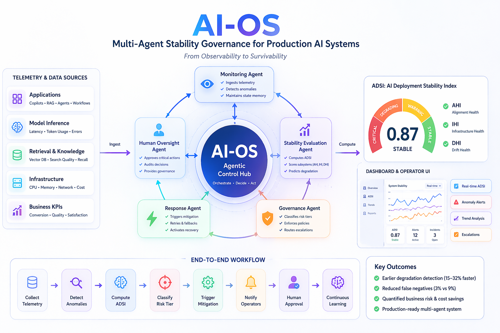

# AI-OS: Multi-Agent Governance for Enterprise AI Reliability

## AI-OS: Multi-Agent Governance for Enterprise AI Reliability

[Like](https://app.readytensor.ai/signup)[Bookmark](https://app.readytensor.ai/signup)

## AI-OS Framework: A Multi-Agent Stability Governance Framework for Enterprise AI Systems <a href="#ai-os_framework_a_multi-agent_stability_governance_framework_for_enterprise_ai_systems" id="ai-os_framework_a_multi-agent_stability_governance_framework_for_enterprise_ai_systems"></a>



```
Enterprise AI systems do not fail instantly. They degrade gradually.
AI-OS was built to detect that degradation before operational failure occurs.
```

:::

**Nur Amirah Mohd Kamil**

AI Engineer • Multi-Agent Systems • Production Reliability Engineering

***

## Executive Summary <a href="#executive_summary" id="executive_summary"></a>

Artificial intelligence is rapidly evolving from an experimental capability into core enterprise infrastructure. Organizations now depend on AI systems for customer support, workflow automation, knowledge retrieval, decision assistance, and internal productivity. As this transition accelerates, reliability becomes just as important as model quality.

However, production AI systems often fail differently from traditional software. Instead of crashing immediately, they tend to degrade gradually through slower responses, weaker retrieval quality, increasing hallucination risk, KPI misalignment, and infrastructure instability. These problems may remain hidden until they begin to affect users or business outcomes.

AI-OS Framework was created to address this gap. It introduces a structured operational model that converts fragmented observability signals into a bounded deployment health score called the AI Deployment Stability Index (ADSI). This enables teams to detect degradation earlier, classify operational risk, and respond with clearer governance controls.

The framework combines multi-agent orchestration, mathematical stability scoring, governance tiers, anomaly visibility, and human oversight principles. Together, these components provide a blueprint for managing enterprise AI systems more safely and effectively.

## Problem Statement <a href="#problem_statement" id="problem_statement"></a>

Most organizations already monitor their AI systems using dashboards and telemetry platforms. They often collect metrics such as latency, throughput, cost, uptime, token usage, and error rates. While useful, these measurements are typically isolated indicators rather than a unified picture of system health.

In practice, enterprise teams need higher-level answers. They need to know whether a deployment remains stable, whether risk is increasing, whether rollback decisions should be considered, and whether human intervention is required.

Traditional monitoring tools are not always designed to answer these governance-oriented questions. They describe symptoms, but they may not clearly communicate survivability.

## Why Existing Monitoring Falls Short <a href="#why_existing_monitoring_falls_short" id="why_existing_monitoring_falls_short"></a>

Many AI incidents are not caused by a single failure. They emerge through combinations of smaller degradations that interact over time.

For example, an organization may experience rising latency while retrieval quality simultaneously declines. Another system may show increasing hallucination rates at the same time business KPIs weaken. In some cases, infrastructure instability can combine with data drift to create inconsistent outputs.

When these signals are viewed separately, teams may underestimate the seriousness of the situation. AI-OS Framework was designed to transform scattered metrics into a more actionable operational view.

This represents a shift in mindset:

Observability measures components.\
Stability governance protects outcomes.

## AI-OS Framework Overview <a href="#ai-os_framework_overview" id="ai-os_framework_overview"></a>

AI-OS acts as a supervisory layer for enterprise AI deployments. Its primary objective is to identify instability before it becomes a business incident.

The framework provides five practical benefits:

It measures deployment health using a bounded score.\
It classifies risk into understandable operational tiers.\
It supports earlier detection of degradation trends.\
It introduces governance pathways for response decisions.\
It preserves human oversight for critical interventions.

Rather than replacing existing monitoring tools, AI-OS complements them by adding decision intelligence on top of raw telemetry.


## Multi-Agent Architecture <a href="#multi-agent_architecture" id="multi-agent_architecture"></a>

AI-OS is structured as a multi-agent system in which specialized agents perform focused operational responsibilities.

#### The Monitoring Agent ingests telemetry streams, watches trends, and identifies unusual movement across metrics. <a href="#the_monitoring_agent_ingests_telemetry_streams_watches_trends_and_identifies_unusual_movement_across" id="the_monitoring_agent_ingests_telemetry_streams_watches_trends_and_identifies_unusual_movement_across"></a>

#### The Stability Agent computes subsystem health indicators and calculates the ADSI score. It also monitors whether performance is improving or deteriorating over time. <a href="#the_stability_agent_computes_subsystem_health_indicators_and_calculates_the_adsi_score_it_also_monit" id="the_stability_agent_computes_subsystem_health_indicators_and_calculates_the_adsi_score_it_also_monit"></a>

#### The Governance Agent interprets the score against defined thresholds. It determines whether the system should remain in normal operation, move into warning mode, escalate for review, or trigger mitigation workflows. <a href="#the_governance_agent_interprets_the_score_against_defined_thresholds_it_determines_whether_the_syste" id="the_governance_agent_interprets_the_score_against_defined_thresholds_it_determines_whether_the_syste"></a>

#### The Response Agent handles operational actions such as retries, fallbacks, alerting, and incident coordination. <a href="#the_response_agent_handles_operational_actions_such_as_retries_fallbacks_alerting_and_incident_coord" id="the_response_agent_handles_operational_actions_such_as_retries_fallbacks_alerting_and_incident_coord"></a>

#### The Human Oversight Agent ensures that high-impact decisions such as rollback approval or policy changes remain accountable and reviewable. <a href="#the_human_oversight_agent_ensures_that_high-impact_decisions_such_as_rollback_approval_or_policy_cha" id="the_human_oversight_agent_ensures_that_high-impact_decisions_such_as_rollback_approval_or_policy_cha"></a>

This modular structure supports safer autonomy because responsibilities are clearly separated.

### Coordination Workflow <a href="#coordination_workflow" id="coordination_workflow"></a>

1. Monitoring Agent detects instability signals
2. Stability Agent recalculates ADSI
3. Governance Agent classifies tier risk
4. Response Agent executes mitigation
5. Human Oversight Agent reviews critical actions

This enables autonomous yet governed production operations.

## AI Deployment Stability Index (ADSI) <a href="#ai_deployment_stability_index_adsi" id="ai_deployment_stability_index_adsi"></a>

The central metric of the framework is the AI Deployment Stability Index.

Three subsystem indices define deployment health.

Alignment Health Index

Infrastructure Health Index

Drift Health Index

### Composite Stability Score <a href="#composite_stability_score" id="composite_stability_score"></a>

Where:

A score near 1.0 indicates a healthy and stable deployment. A score near 0.0 indicates severe instability.

The three indices capture complementary dimensions of performance.

The Alignment Health Index measures whether the AI system continues to meet intended business outcomes such as task quality, user satisfaction, and KPI alignment.

The Infrastructure Health Index measures technical reliability such as latency performance, service availability, and retrieval responsiveness.

The Drift Health Index measures whether the system is changing away from expected behavior over time due to evolving inputs, embeddings, usage patterns, or environmental conditions.

By averaging these signals, the framework avoids over-reliance on any single metric.

### Governance Tiers <a href="#governance_tiers" id="governance_tiers"></a>

To make the score operationally useful, ADSI maps into four decision tiers.

A score above 0.85 is considered **Stable**, meaning the deployment is healthy and normal operations may continue.

A score between 0.75 and 0.85 is **Warning**, suggesting closer monitoring and investigation.

A score between 0.65 and 0.75 is **Degrading**, indicating that intervention should be considered soon.

A score below 0.65 is **Critical**, meaning immediate mitigation, rollback, or escalation may be required.

These thresholds are configurable to suit organizational tolerance and business context.

## Methodology <a href="#methodology" id="methodology"></a>

The framework was evaluated using synthetic telemetry simulations that emulate common production AI operating conditions. This approach allows controlled benchmarking without exposing proprietary enterprise data.

The simulation modeled multiple phases of deployment behavior. Stable periods represented healthy low-variance operation. Warning phases introduced early degradation signals. Critical phases simulated compound failures across several metrics simultaneously.

Signals used in the experiments included KPI error, retrieval quality, latency deviation, and embedding shift.

Performance was measured using practical operational metrics such as detection speed, false negatives, classification accuracy, and area under curve (AUC).

## Experimental Setup <a href="#experimental_setup" id="experimental_setup"></a>

Across benchmark scenarios, AI-OS consistently identified instability earlier than baseline approaches focused on single metrics.

Latency-only monitoring often reacted late because it missed quality deterioration. Drift-only approaches sometimes detected movement without understanding business impact. Generic dashboards exposed metrics but lacked unified escalation logic.

The ADSI framework demonstrated faster degradation recognition, lower false negative rates, and stronger overall classification performance.

Illustrative benchmark results included:

* 15–32% faster degradation detection
* Significant reduction in false negatives
* 95%+ classification accuracy
* Strong AUC performance

These outcomes suggest that bounded composite scoring can improve production awareness in enterprise AI environments.

### Dataset <a href="#dataset" id="dataset"></a>

The evaluation used the **AI-OS Enterprise Stability Telemetry Dataset v1.0,** a synthetic benchmark dataset designed to simulate realistic operational decline, anomaly transitions, and governance tier movement.

Dataset Link:\
<a href="https://github.com/strdst7/ai-os-framework/tree/main/data" target="_blank">https://github.com/strdst7/ai-os-framework/tree/main/data</a>

## Implementation Walkthrough <a href="#implementation_walkthrough" id="implementation_walkthrough"></a>

A simplified implementation of the ADSI score is shown below.\
AI-OS detected degradation 15–32% earlier.

```python
def compute_adsi(ahi, ihi, dhi):
    score = (ahi + ihi + dhi) / 3
    return round(max(0.0, min(score, 1.0)), 3)
```

This implementation enforces bounded outputs between zero and one, ensuring consistent dashboards and threshold logic.

Tier classification can then be applied:

```python
def classify_tier(score):
    if score >= 0.85:
        return "Stable"
    elif score >= 0.75:
        return "Warning"
    elif score >= 0.65:
        return "Degrading"
    return "Critical"
```

This makes the framework interpretable and deployable in real operational systems.

#### Technical Assumptions <a href="#technical_assumptions" id="technical_assumptions"></a>

The current version assumes that subsystem signals can be normalized into a common range between zero and one. It also uses equal weighting across indices as a transparent baseline.

The synthetic benchmark is intended to approximate realistic degradation patterns, although live enterprise environments may exhibit more complex dependencies.

Thresholds should therefore be calibrated for each organization rather than treated as universal constants.

These assumptions are explicit so they can be improved in future releases.

## Security, Governance & Safety <a href="#security_governance_safety" id="security_governance_safety"></a>

Security controls:

* environment variable secrets
* no hardcoded credentials
* dependency management
* validated APIs
* bounded outputs

Governance controls:

* interpretable scoring logic
* tier-based escalation
* auditable decisions
* human override pathways

Safety controls:

* false positive threshold tuning
* controlled mitigation triggers
* transparent incident review

### Code Explanation <a href="#code_explanation" id="code_explanation"></a>

To improve reproducibility and practical usability, this section explains the core implementation snippets used in AI-OS and connects each example directly to the system concepts introduced earlier.

Rather than presenting code in isolation, each snippet below demonstrates how theoretical stability modeling becomes deployable production software.

#### ADSI Stability Score Computation <a href="#adsi_stability_score_computation" id="adsi_stability_score_computation"></a>

Reference Implementation

def compute\_adsi(ahi: float, ihi: float, dhi: float) -> float:\
"""\
Compute bounded AI Deployment Stability Index.\
"""\
score = (ahi + ihi + dhi) / 3\
return round(max(0.0, min(score, 1.0)), 3)

### What This Code Does <a href="#what_this_code_does" id="what_this_code_does"></a>

This function calculates the core AI-OS metric:

ADSI = (AHI + IHI + DHI) / 3

Where:

* ahi = Alignment Health Index
* ihi = Infrastructure / Retrieval Health
* dhi = Drift Health Index

### Key Implementation Choices <a href="#key_implementation_choices" id="key_implementation_choices"></a>

Averaging Three Signals

score = (ahi + ihi + dhi) / 3

This reflects the baseline equal-weight model discussed in the paper.

It ensures:

* simplicity
* interpretability
* transparent governance

### Bounded Output Protection <a href="#bounded_output_protection" id="bounded_output_protection"></a>

max(0.0, min(score, 1.0))

This guarantees ADSI always remains in:

\[0,1]

This prevents invalid operational scores due to noisy inputs or future weighting changes.

### Why Rounding Matters <a href="#why_rounding_matters" id="why_rounding_matters"></a>

round(..., 3)

Three-decimal precision is operationally readable while still numerically useful.

Example:

* 0.87341 → 0.873

### Why It Matters <a href="#why_it_matters" id="why_it_matters"></a>

This small function operationalizes the entire paper’s theoretical contribution.

### Stability Tier Classification <a href="#stability_tier_classification" id="stability_tier_classification"></a>

Reference Implementation

def classify\_tier(score: float) -> str:\
if score >= 0.85:\
return "Stable"\
elif score >= 0.75:\
return "Warning"\
elif score >= 0.65:\
return "Degrading"\
return "Critical"

#### What This Code Does <a href="#what_this_code_does" id="what_this_code_does"></a>

Converts a numeric score into an actionable governance state.

Instead of asking operators to interpret decimals, AI-OS translates metrics into clear operational language.

#### Why These Thresholds Exist <a href="#why_these_thresholds_exist" id="why_these_thresholds_exist"></a>

Thresholds were chosen to create progressive risk zones:

Score Tier Action\
≥ 0.85 Stable Continue normal ops\
0.75–0.85 Warning Monitor closely\
0.65–0.75 Degrading Investigate\
< 0.65 Critical Immediate mitigation

#### Why This Matters <a href="#why_this_matters" id="why_this_matters"></a>

Executives and operators act faster on labels than raw numbers.

#### Retry Logic for Resilience <a href="#retry_logic_for_resilience" id="retry_logic_for_resilience"></a>

Reference Implementation

import time\
def retry\_call(fn, retries=3):\
for attempt in range(retries):\
try:\
return fn()\
except Exception:\
time.sleep(2 \*\* attempt)\
return None

#### What This Code Does <a href="#what_this_code_does" id="what_this_code_does"></a>

This function retries transient failures such as:

* temporary API outages
* network jitter
* short-lived database errors
* service warmup delays

#### Key Line Explained <a href="#key_line_explained" id="key_line_explained"></a>

time.sleep(2 \*\* attempt)

This is exponential backoff.

Wait schedule:

* Attempt 1 → 1 sec
* Attempt 2 → 2 sec
* Attempt 3 → 4 sec

This avoids aggressive retry storms that can worsen outages.

#### Why This Matters <a href="#why_this_matters" id="why_this_matters"></a>

AI systems often depend on external services. Reliability requires graceful recovery, not immediate failure.

#### Monitoring Health Check Endpoint <a href="#monitoring_health_check_endpoint" id="monitoring_health_check_endpoint"></a>

Reference Implementation

def healthcheck():\
return {\
"status": "ok",\
"service": "AI-OS"\
}

#### What This Code Does <a href="#what_this_code_does" id="what_this_code_does"></a>

Provides a minimal heartbeat endpoint for orchestration platforms.

Used by:

* Kubernetes probes
* load balancers
* uptime monitors
* deployment automation

#### Why This Matters <a href="#why_this_matters" id="why_this_matters"></a>

Production AI systems must be observable themselves, not only monitor others.

### Multi-Agent Coordination Example <a href="#multi-agent_coordination_example" id="multi-agent_coordination_example"></a>

Reference Implementation

def run\_cycle(telemetry):\
obs = monitoring\_agent.observe(telemetry)\
score = stability\_agent.evaluate(obs)\
tier = governance\_agent.decide(score)\
action = response\_agent.act(tier)\
return {\
"score": score,\
"tier": tier,\
"action": action\
}

#### What This Code Does <a href="#what_this_code_does" id="what_this_code_does"></a>

This snippet demonstrates AI-OS as a cooperative multi-agent workflow.

Step-by-step

1. Monitoring Agent

observe(telemetry)

Reads incoming production signals.

2. Stability Agent

evaluate(obs)

Computes ADSI.

3. Governance Agent

decide(score)

Maps score to risk tier.

4. Response Agent

act(tier)

Triggers mitigation.

#### Why This Matters <a href="#why_this_matters" id="why_this_matters"></a>

This directly implements the paper’s claim that AI operations should move from passive monitoring to coordinated autonomous governance.

### Testing Example <a href="#testing_example" id="testing_example"></a>

Reference Implementation

def test\_adsi\_range():\
score = compute\_adsi(0.9, 0.8, 0.7)\
assert 0 <= score <= 1

### What This Code Validates <a href="#what_this_code_validates" id="what_this_code_validates"></a>

Ensures ADSI never leaves bounded range.

Without this test, future code changes could accidentally create invalid scores such as:

* 1.12
* -0.08

#### Why This Matters <a href="#why_this_matters" id="why_this_matters"></a>

Testing mathematical invariants is essential for trustworthy production systems.

#### Why These Snippets Were Chosen <a href="#why_these_snippets_were_chosen" id="why_these_snippets_were_chosen"></a>

The included code focuses on high-value production concerns:

* scoring correctness
* interpretability
* resilience
* orchestration
* maintainability
* testing discipline

These examples were selected because they represent real enterprise engineering priorities rather than toy demonstrations.

### Summary <a href="#summary" id="summary"></a>

The code snippets in AI-OS are not decorative examples.

They are minimal reference implementations of the framework’s central claims:

* bounded stability modelling
* actionable governance tiers
* resilient failure handling
* cooperative multi-agent operations
* testable production engineering

This bridges research concepts with deployable software practice.\
:::

## Testing & Validation <a href="#testing_validation" id="testing_validation"></a>

Testing suite includes:

* unit tests for ADSI logic
* boundary range tests
* anomaly detection tests
* API endpoint tests
* inter-agent handoff tests
* governance escalation tests
* CI/CD automation workflows

Example:

```
def test_adsi_range():
    score = compute_adsi(...)
    assert 0 <= score <= 1
```

## Installation Guide <a href="#installation_guide" id="installation_guide"></a>

Run Locally

```bash
git clone https://github.com/strdst7/ai-os-framework
cd ai-os-framework
pip install -r requirements.txt
streamlit run app.py
```

## API Mode <a href="#api_mode" id="api_mode"></a>

```bash
uvicorn src.main:app --reload
```

### Usage Guide <a href="#usage_guide" id="usage_guide"></a>

1. Launch dashboard
2. View live ADSI score
3. Simulate degradation
4. Observe tier changes
5. Review anomaly alerts
6. Apply mitigation workflows

#### Metric Normalization Assumption <a href="#metric_normalization_assumption" id="metric_normalization_assumption"></a>

All subsystem signals are assumed to be transformable into bounded comparable scales within:

\[0,1]

Examples:

* KPI error → normalized inverse health score
* retrieval quality → bounded relevance score
* latency deviation → scaled performance penalty
* embedding drift → normalized semantic shift metric

Reasoning

A bounded common scale enables interpretable aggregation across heterogeneous signals.

Potential Impact

If normalization functions are poorly calibrated, subsystem importance may be distorted.

#### Monotonic Degradation Assumption <a href="#monotonic_degradation_assumption" id="monotonic_degradation_assumption"></a>

The experimental simulations assume that compound failures generally worsen over time unless mitigation occurs.

Examples:

* latency gradually rises
* retrieval quality declines
* drift accumulates
* KPI alignment weakens

Reasoning

This reflects many real production incidents where unresolved degradation compounds progressively.

Potential Impact

Some real systems exhibit oscillatory or bursty failures, which may require adaptive temporal modeling.

#### Equal Weighting Assumption <a href="#equal_weighting_assumption" id="equal_weighting_assumption"></a>

The baseline ADSI model uses equal contribution from subsystem indices:

ADSI = (AHI + IHI + DHI) / 3

Reasoning

Equal weighting provides transparency, interpretability, and a neutral starting point for benchmarking.

Potential Impact

In domain-specific deployments, certain signals may deserve higher weighting (e.g., latency in real-time systems, alignment in regulated systems).

#### Independent Signal Contribution Assumption <a href="#independent_signal_contribution_assumption" id="independent_signal_contribution_assumption"></a>

Subsystem metrics are combined additively and are assumed to contribute independently in the baseline model.

Reasoning

This simplifies first-generation deployment stability scoring.

Potential Impact

Real systems may contain nonlinear dependencies such as:

* latency causing KPI loss
* retrieval decay increasing hallucination rate
* infrastructure faults amplifying drift impact

Future versions may model interaction effects explicitly.

#### Synthetic Telemetry Representativeness Assumption <a href="#synthetic_telemetry_representativeness_assumption" id="synthetic_telemetry_representativeness_assumption"></a>

The evaluation uses synthetic telemetry designed to approximate enterprise AI operational patterns.

Reasoning

Synthetic data enables:

* controlled degradation injection
* reproducibility
* safe experimentation
* benchmark consistency

Potential Impact

Live enterprise environments may contain noisier, nonstationary, and domain-specific behavior not fully captured in simulation.

#### Threshold Governance Assumption <a href="#threshold_governance_assumption" id="threshold_governance_assumption"></a>

Operational tiers were defined as:

* Stable ≥ 0.85
* Warning 0.75–0.85
* Degrading 0.65–0.75
* Critical < 0.65

Reasoning

Tier thresholds create actionable governance states for operators.

Potential Impact

Thresholds should be calibrated per organization, workload criticality, and SLA tolerance.

#### Human-in-the-Loop Assumption <a href="#human-in-the-loop_assumption" id="human-in-the-loop_assumption"></a>

Critical actions are assumed to require operator review or approval in enterprise settings.

Reasoning

Many organizations require human oversight for rollback, escalation, and compliance-sensitive actions.

Potential Impact

Highly autonomous systems may choose automated mitigation pathways instead.

#### Infrastructure Reliability Assumption <a href="#infrastructure_reliability_assumption" id="infrastructure_reliability_assumption"></a>

The supervisory control plane is assumed to remain available during monitored incidents.

Reasoning

AI-OS evaluates target systems and depends on telemetry availability.

Potential Impact

If observability pipelines fail simultaneously, external redundancy or fallback monitoring may be required.

#### Security Boundary Assumption <a href="#security_boundary_assumption" id="security_boundary_assumption"></a>

Telemetry inputs and API interfaces are assumed to operate within trusted enterprise network controls.

Reasoning

The framework focuses on operational stability rather than adversarial cybersecurity defense.

Potential Impact

Hostile environments may require additional controls such as:

* signed telemetry
* zero-trust authentication
* anomaly spoof detection
* secure agent identity layers

#### Summary <a href="#summary" id="summary"></a>

These assumptions do not weaken the framework; they clarify its baseline operating model.

AI-OS is intentionally modular, allowing future deployments to replace assumptions with:

* adaptive weighting
* nonlinear interactions
* live telemetry calibration
* autonomous remediation policies
* industry-specific thresholds

Explicit assumptions strengthen scientific validity, reproducibility, and deployment trustworthiness.\
:::

## Technical Assumptions and Design Constraints <a href="#technical_assumptions_and_design_constraints" id="technical_assumptions_and_design_constraints"></a>

To ensure transparency, reproducibility, and proper interpretation of results, the following technical assumptions were made during the design and evaluation of the AI-OS framework.

These assumptions are explicit, parameterizable, and intended to simplify controlled experimentation while preserving real-world relevance.

## Limitations <a href="#limitations" id="limitations"></a>

Current limitations:

* synthetic telemetry rather than live enterprise data
* static weighting model
* simplified subsystem dependencies
* limited multi-agent production pilots
* no industry-specific calibration yet

## Future Work <a href="#future_work" id="future_work"></a>

Future versions of AI-OS may include predictive failure forecasting, autonomous remediation agents, distributed control planes, richer enterprise integrations, and policy-aware governance workflows.

As AI systems become increasingly mission-critical, survivability engineering is likely to become an essential operational discipline.

## Reader Next Steps <a href="#reader_next_steps" id="reader_next_steps"></a>

Readers interested in extending this work may explore adjacent fields such as multi-agent systems, anomaly detection, MLOps, reliability engineering, and AI governance.

Practical next projects could include building a live ADSI dashboard, connecting streaming telemetry, integrating Slack or Teams alerts, or experimenting with adaptive weighting strategies.

The framework is intentionally designed as a foundation for further development.

### What to Learn Next <a href="#what_to_learn_next" id="what_to_learn_next"></a>

To extend the ideas introduced in AI-OS, the most valuable next topics are:

A. Multi-Agent Systems

Study how specialized agents coordinate, communicate, and divide responsibilities.

Recommended topics:

* agent orchestration
* planning systems
* memory architectures
* tool-using agents
* human-in-the-loop systems

Why it matters:

AI-OS can evolve from supervisory automation into full cooperative agent ecosystems.

B. MLOps and AI Reliability Engineering

Learn how production AI systems are deployed, monitored, and governed.

Recommended topics:

* CI/CD for ML
* model monitoring
* drift detection
* observability pipelines
* rollback strategies
* incident response systems

Why it matters:

AI-OS is fundamentally an AI reliability platform.

C. Control Systems and Feedback Loops

Study how engineering systems maintain stability under disturbance.

Recommended topics:

* PID control
* state estimation
* signal smoothing
* closed-loop systems
* bounded stability theory

Why it matters:

ADSI is conceptually a control-system stability signal for AI deployments.

D. Statistics for Operations

Learn how to evaluate uncertainty and incidents quantitatively.

Recommended topics:

* anomaly detection
* confidence intervals
* Monte Carlo simulation
* hypothesis testing
* ROC curves

Why it matters:

The AI-OS evaluation layer depends on statistical rigor.

E. Security and Governance

Study how enterprise systems remain safe and auditable.

Recommended topics:

* secrets management
* RBAC / IAM
* audit trails
* policy enforcement
* zero-trust design

Why it matters:

Production AI without governance becomes enterprise risk.

### Suggested Portfolio Projects <a href="#suggested_portfolio_projects" id="suggested_portfolio_projects"></a>

Readers looking to strengthen their careers can build:

Beginner

* AI health dashboard
* drift alert service
* KPI anomaly detector

Intermediate

* enterprise model risk scoring system
* self-healing inference router
* cost-aware model switcher

Advanced

* autonomous AI incident commander
* multi-agent governance platform
* predictive survivability engine

### Helpful Resources <a href="#helpful_resources" id="helpful_resources"></a>

Engineering

* FastAPI documentation
* Streamlit documentation
* Docker documentation
* GitHub Actions CI/CD docs

Machine Learning Operations

* MLflow
* Weights & Biases
* Evidently AI
* Prometheus + Grafana

Multi-Agent Systems

* LangGraph
* CrewAI
* AutoGen
* semantic memory systems

Statistics

* scikit-learn
* SciPy
* pandas
* NumPy

### Questions to Explore Next <a href="#questions_to_explore_next" id="questions_to_explore_next"></a>

Readers should ask:

* Can AI deployments self-detect failure before humans notice?
* Should governance agents control model routing?
* How should enterprises certify AI stability?
* Can survivability become an industry benchmark?
* What metrics truly predict business failure?

These questions can become future research papers or startups.

Enterprise AI is still early.

The builders who learn reliability, governance, and agentic operations now will shape the next generation of AI infrastructure.

AI-OS is one blueprint.

Your next version can be better.\
:::

## # Maintenance and Support Status <a href="#maintenance_and_support_status" id="maintenance_and_support_status"></a>

Current Version: v1.0.0

The project is maintained as an active open-source framework with planned iterative improvements.

Expected updates include documentation refinement, telemetry connectors, dashboard tooling, anomaly modules, and predictive survivability features.

Support and issue reporting are available through the project repository.

Repository:\
<a href="https://github.com/strdst7/ai-os-framework" target="_blank">https://github.com/strdst7/ai-os-framework</a>

### Current Release Status <a href="#current_release_status" id="current_release_status"></a>

Stable Public Version

Current Version: v1.0.0

Release classification:

* Production-ready reference implementation
* Research-backed prototype with deployable architecture
* Open-source educational and enterprise experimentation use

Version v1.0.0 includes:

* ADSI bounded stability scoring
* multi-agent supervisory architecture
* Streamlit dashboard
* FastAPI interface
* anomaly detection layer
* governance tier logic
* documentation and tests

### Support Channels <a href="#support_channels" id="support_channels"></a>

Users and reviewers can engage through the following channels.

Primary Repository Support

GitHub Issues:

* bug reports
* feature requests
* installation problems
* documentation improvements

Community Support

Discussion boards / GitHub Discussions for:

* implementation questions
* deployment advice
* architecture ideas

Professional Contact

For enterprise collaboration or technical inquiries:

Maintainer: Nur Amirah Mohd Kamil

<a href="mailto:ai@nuramirahmohdkamil.com" target="_blank">ai@nuramirahmohdkamil.com</a>

### Dependency Maintenance Strategy <a href="#dependency_maintenance_strategy" id="dependency_maintenance_strategy"></a>

AI-OS dependencies are periodically reviewed for:

* security vulnerabilities
* compatibility changes
* deprecated libraries
* performance regressions

Recommended tooling:

* Dependabot
* pip-audit
* pinned requirements
* CI regression tests

### Documentation Maintenance <a href="#documentation_maintenance" id="documentation_maintenance"></a>

Documentation is treated as a first-class asset.

Maintained artifacts include:

* README
* installation guide
* architecture notes
* troubleshooting docs
* change log
* API examples

All major releases should update documentation simultaneously.

### Backward Compatibility Policy <a href="#backward_compatibility_policy" id="backward_compatibility_policy"></a>

Where possible:

* public APIs remain stable across minor versions
* dashboards preserve user workflows
* scoring logic changes are documented clearly

Breaking changes trigger a MAJOR version release.

### Security Support Status <a href="#security_support_status" id="security_support_status"></a>

Security issues should be reported privately before public disclosure when possible.

Maintenance priorities include:

* dependency patching
* secret management guidance
* API validation hardening
* infrastructure best practices

### Roadmap for Future Maintenance <a href="#roadmap_for_future_maintenance" id="roadmap_for_future_maintenance"></a>

Planned future releases include:

v1.1

* configurable subsystem weights
* expanded metrics ingestion
* improved dashboard UX

v1.2

* live telemetry connectors
* Slack / Teams alert integrations
* richer anomaly analytics

v2.0

* predictive failure forecasting
* autonomous remediation agents
* distributed enterprise control plane

### Sustainability Statement <a href="#sustainability_statement" id="sustainability_statement"></a>

AI-OS is designed to remain maintainable through:

* modular architecture
* separated services
* automated testing
* documented interfaces
* semantic versioning discipline

This reduces technical debt and enables future contributors.

#### Reader Guidance <a href="#reader_guidance" id="reader_guidance"></a>

If using AI-OS today:

1. Start with the current stable release
2. Monitor changelog updates
3. Pin dependencies for production use
4. Report issues through repository channels
5. Contribute improvements where relevant

### Summary <a href="#summary" id="summary"></a>

AI-OS is not a static publication artifact.

It is an evolving operational framework with:

* active roadmap direction
* versioned releases
* defined maintenance practices
* support pathways
* future enterprise scalability plans

Clear maintenance status strengthens trust, adoption readiness, and long-term technical credibility.\
:::

## Contact Information of Asset Creators <a href="#contact_information_of_asset_creators" id="contact_information_of_asset_creators"></a>

To improve accessibility, supportability, and collaboration readiness, the following contact and support channels are provided for the AI-OS framework.

AI-OS is maintained as an open technical asset intended for learning, experimentation, and future enterprise expansion.

### Primary Maintainer <a href="#primary_maintainer" id="primary_maintainer"></a>

Nur Amirah Mohd Kamil\
Independent AI Systems Architect

Focus Areas:

* Agentic AI Systems
* Multi-Agent Production Architecture
* Enterprise Reliability Engineering
* AI Governance and Stability Modeling

### Repository and Source Code <a href="#repository_and_source_code" id="repository_and_source_code"></a>

GitHub Repository

<a href="https://github.com/strdst7/ai-os-framework" target="_blank">https://github.com/strdst7/ai-os-framework</a>

Recommended for:

* source code access
* release updates
* documentation
* contribution tracking
* issue reporting

### Technical Support Channel <a href="#technical_support_channel" id="technical_support_channel"></a>

GitHub Issues

Recommended for:

* bug reports
* installation issues
* unexpected behavior
* feature requests
* documentation corrections

Suggested issue template:

Title:\
Clear summary\
Environment:\
OS / Python version / Deployment platform\
Problem Description:\
Steps to Reproduce:\
Expected Result:\
Actual Result:

### Professional Contact <a href="#professional_contact" id="professional_contact"></a>

For professional collaboration, technical discussions, partnerships, or enterprise inquiries:

LinkedIn

<a href="https://www.linkedin.com/in/nur-amirah-mohd-kamil-/" target="_blank">https://www.linkedin.com/in/nur-amirah-mohd-kamil-/</a>

#### Community Support (Planned) <a href="#community_support_planned" id="community_support_planned"></a>

Future community channels may include:

* GitHub Discussions
* Discord developer community
* technical Q\&A forum
* contributor workspace

These channels are planned as adoption grows.

### Documentation Resources <a href="#documentation_resources" id="documentation_resources"></a>

Users seeking help should first review:

* README.md
* Installation Guide
* Troubleshooting Guide
* Architecture Notes
* Changelog

These materials resolve most common setup issues quickly.

### Summary <a href="#summary" id="summary"></a>

AI-OS support channels are intentionally transparent and developer-friendly.

Primary contact pathways include:

* GitHub repository
* GitHub Issues
* Professional networking channels
* Documentation resources

Providing clear maintainer access improves trust, usability, and long-term adoption confidence.\
:::

## Conclusion <a href="#conclusion" id="conclusion"></a>

Production AI systems require more than dashboards.

They require systems that can observe changing conditions, quantify operational risk, classify instability, trigger intelligent escalation, and preserve human accountability.

AI-OS Framework demonstrates that enterprise AI stability can be formally modeled, mathematically bounded, operationally governed, and continuously improved.

This represents a broader shift in how organizations manage intelligent systems:

This marks a shift:\
''''\
From observability\
To survivability.\
''''

## Links <a href="#links" id="links"></a>

### Live Demo <a href="#live_demo" id="live_demo"></a>

```bash
# https://ai-osdev.streamlit.app/
```

### Framework Repository <a href="#framework_repository" id="framework_repository"></a>

```bash
https://github.com/strdst7/ai-os-framework
```

### Production Repository <a href="#production_repository" id="production_repository"></a>

```bash
https://github.com/strdst7/ai-os
```

### Full Paper <a href="#full_paper" id="full_paper"></a>

```
See PAPER.md
```

### Dataset <a href="#dataset" id="dataset"></a>

```bash
https://github.com/strdst7/ai-os-framework/tree/main/data
```

### License <a href="#license" id="license"></a>

### MIT License <a href="#mit_license" id="mit_license"></a>

***

### Author <a href="#author" id="author"></a>

Independent AI Systems Architect

#### © 2026 Nur Amirah Mohd Kamil <a href="#id-2026_nur_amirah_mohd_kamil" id="id-2026_nur_amirah_mohd_kamil"></a>

:::

### Files

* <a href="https://app.readytensor.ai/login" target="_blank">AI\_\_\_OS.pdf</a>
* <a href="https://app.readytensor.ai/login" target="_blank">methodology.md</a>

[**Your publication could be next!**&#x4A;oin us today and publish for freeSign Up for free!](https://app.readytensor.ai/signup)

### Files

* <a href="https://app.readytensor.ai/login" target="_blank">AI\_\_\_OS.pdf</a>
* <a href="https://app.readytensor.ai/login" target="_blank">methodology.md</a>
